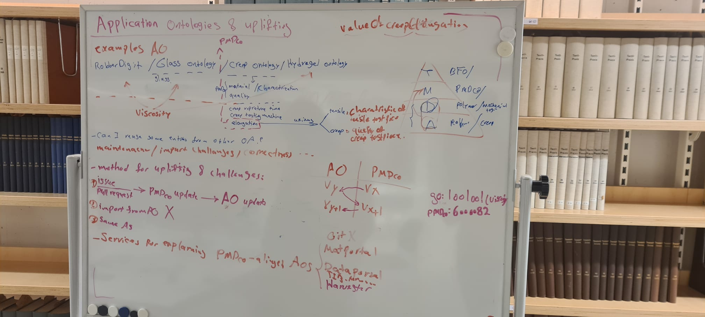
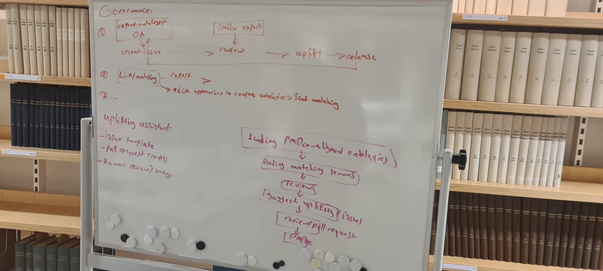
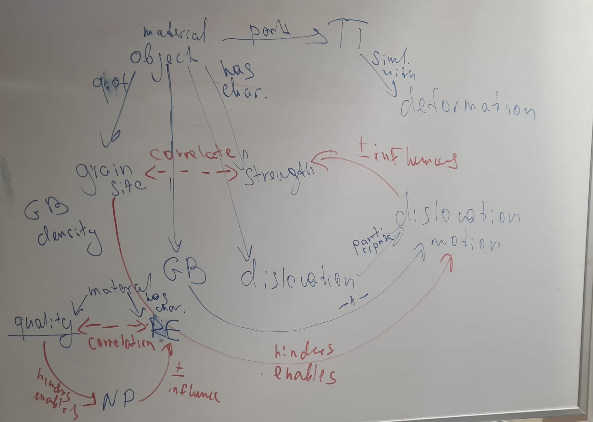
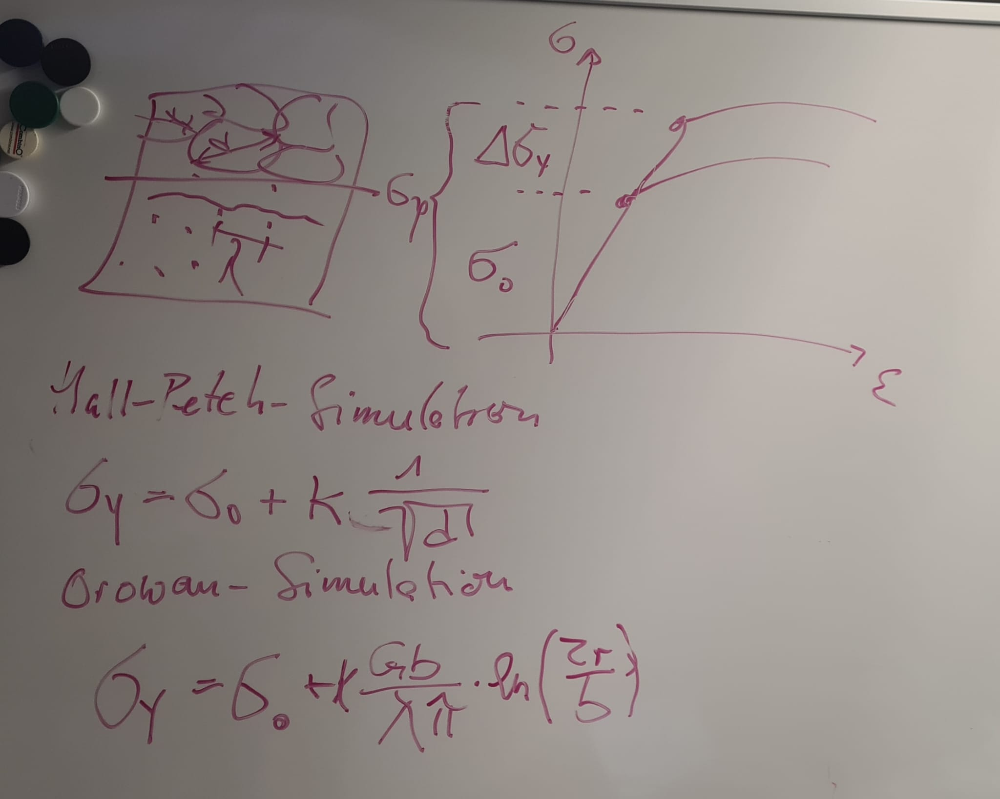
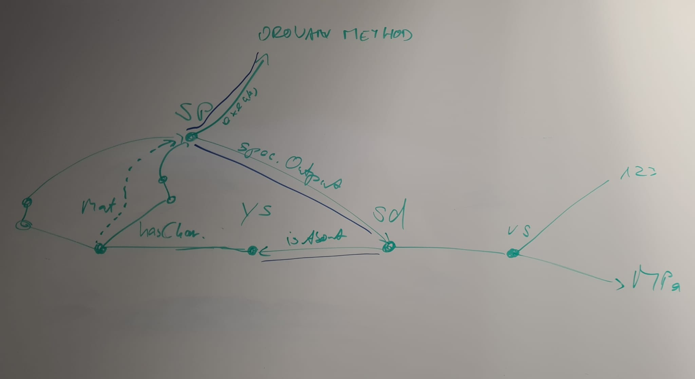
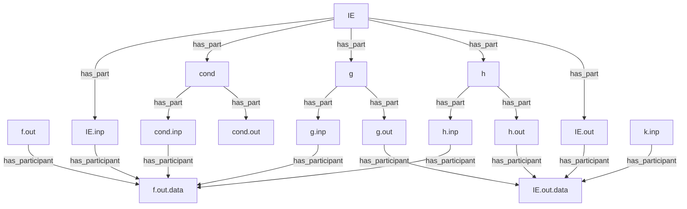
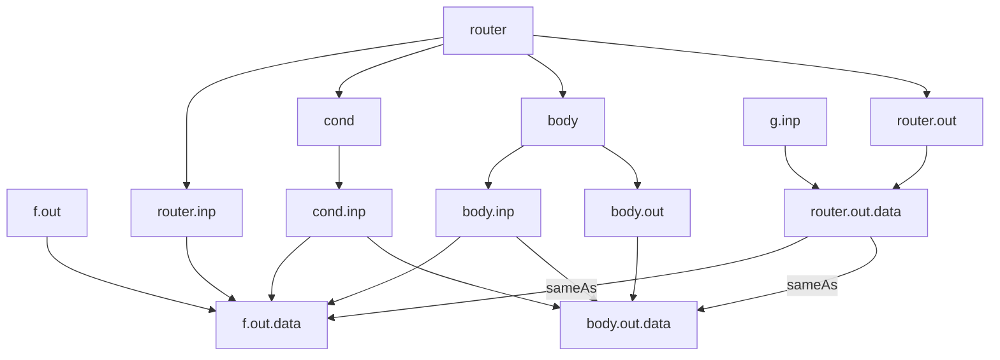

# PMDco Hackathon IV @ BAM

**18th–20th November 2026 | Lunch 2 Lunch**

> **Link to this document**: [HackMD document for agenda and protocol of PMD Hackathon 4](https://hackmd.io/EuA4R4ZWQUm_v_kgJwK0UA)
>  
> **Living document / collaborative protocol:** This document contains the workshop agenda and is intended to be updated collaboratively during the hackathon. Topics, working groups, results, decisions, deliverables, pull requests, and follow-up activities can be documented directly here. After the Hackathon event, this document is intended to be the protocol / documentation of the event.
>
> **Note:** Agenda may be subject to change during the event.

**4th PMD Ontology Hackathon Website**: [https://materialdigital.github.io/ontology-hackathon-4](https://materialdigital.github.io/ontology-hackathon-4/)
**4th PMD Ontology Hackathon GitHub Repository**: [https://github.com/materialdigital/ontology-hackathon-4](https://github.com/materialdigital/ontology-hackathon-4)

---
# Agenda
## Day 1: 18th November

| Time | Agenda |
|---|---|
| **12:00 PM** | **Registration and Get Together** |
| **01:00 PM** | Welcoming / Motivation (BAM / HAP “Semantic Interoperability” Lead) |
|  | Introduction Round (all); Find Topics; Fix the Agenda; Find Working Groups |
| **02:00 PM** | Short Break |
| **02:15 PM** | Brief Introduction to PMD Core Ontology: New Structure, Concepts, Releases, Discussions |
| **02:15 PM** | Beginner’s Course (parallel to other activities, Haus 30, Room: 03.401)|
| **03:00 PM** | Coffee Break (+ Nibbles) |
| **03:30 PM** | **Group Sessions according to Topics** | 
| **06:00 PM** | Presentation of First Results (all) |
| **07:30 PM** | End of Day 1 |

---

## Day 2: 19th November

| Time | Agenda |
|---|---|
| **09:30 AM** | **Parallel Group Sessions, Set-up and start** |
| **10:00 AM** | Coffee available (+ Nibbles) during Group Sessions |
| **11:30 AM** | Plenum: Show Your Results and Pull Requests |
| **11:45 AM** | Group Picture |
| **12:00 PM** | Lunch @ BAM Canteen |
| **01:30 AM** | Continued Group Session in accordance with Topics |
| **03:00 PM** | Coffee Break |
| **03:30 PM** | Continued Group Sessions in accordance with Topics |
| **04:45 PM** | Coffee Break |
| **05:00 PM** | Plenum: Presentation of Results from the Group Sessions |
| **06:30 PM** | End of Day 2; leave venue to travel to restaurant (tba) |
| **07:00 PM** | Dinner @ Restaurant [Macedonia](https://www.google.com/maps/place/Restaurant+Macedonia/@52.4434021,13.2926162,17z/data=!3m1!4b1!4m6!3m5!1s0x41653b5cbad83b37:0xb1e85406faa43b96!8m2!3d52.4434021!4d13.2951911!16s%2Fg%2F1td5_rz_!5m1!1e1?entry=ttu&g_ep=EgoyMDI2MTExNi4wIKXMDSoASAFQAw%3D%3D) (at own cost) |

---

## Day 3: 20th November

| Time / Format | Agenda |
|---|---|
| **09:30 AM** | **Get Together** |
| **10:00 AM** | Coffee Break (+ Nibbles) |
| **Plenum** | Live Coding Session for semantic representation of methods |
| **Plenum** | Expert Round; Fixation of Results; Deliverables |
| **Plenum** | What’s Next? → Set up Future (Online) Meetings |
| **Plenum, time & mood permitting** | Coffee Break(s) |
| **11:30 AM** | Wrap up |
| **12:30 PM** | End of Hackathon |

---

# Working groups and notes

## Topics

### Topic 1: (Re-)Organization of Processes (Classes) in PMDco
> Process descriptions, organization and axiomatization need to be reworked.
### Topic 2: Computational processes in PMDco 
> Semantically represent processes to describe simulations, analysis workflows, etc. Refers to [PMDco GitHub issues #533](https://github.com/materialdigital/core-ontology/issues/533).
### Topic 3: Microstructure Module
> Discussions / decision on conceptualization of the PMDco module representing microstructure.
### Topic 4: Modularization of PMDco
> Discussion on organizing modules in PMDco; What is a PMDco module? Distinction to application / domain ontologies.
### Topic 5: Semantic Patterns
> Documentation of semantic patterns (pattern catalogue, RAG).
### Topic 6: Coordination of Uplifting Concepts (Uplifting Party)
> Application and domain ontology developers come together to identify concepts in their ontologies as candidates for uplifting to PMDco.
### Topic 7: Microscopy ontology (MO) linked to Microstructure Ontology
> Aligning Microscopy Ontology (MO) with new PMDco (3.x) version, particularly with respect to concepts represented in microstructure ontology.

### Beginner's course (by Dr. Khashayar Razghandi)
> Introducing beginners to ontologies and semantic representations in general, and to PMDco as one semantic anchor in the field of materials science and engineering (MSE). Look and Feel in Protégé.

## Organization of working groups

**Day 1**
Group 1: Processes, Modules (Topic 1)
Group 2: Computational Processes (Topic 2)
Group 3: Coordination of Uplifting Concepts (Topic 6)

**Day 2**
***morning session***
Group 1: Processes, Modules (Topic 1)
Group 2: Computational Processes (Topic 2)
Group 3: Microstructure (Topic 3)

***early afternoon***
Group Plenum: Processes, Modules (Topic 1) + Computational Processes (Topic 2) (include computational )

***afternoon***
Group 4: Causal Chains (process --> structure --> properties)
Group 5: Semantic Patterns (Topic 5)


### Topic 1: (Re-)Organization of Processes (Classes) in PMDco
- **Objectives / questions:**
    - We need to rework the representation of processes
    - Thus, we want to find a fundamental categorization of processes
- **Decisions:**
    - gh issue: [#482](https://github.com/materialdigital/core-ontology/issues/482)
highest level hierarchy by what disjoint:
- continuous or discontinuous, like cyclic or periodically - maybe define by speficications cyclic step wise contoninious 
- process property profiles, maybe geerically to qualities (signal processing)
- [vde vdi terminology ](https://term.vdi-online.de) as ground truth for primary hierachy, proably ahs the terminology of the comunity to add...is maybe a good candidate (also some DIN Standards)
- disiplin alike categories: mechanical, electrical, ... - maybe not needed and not very usefull 
- by intent: harding intent, softening.. also microstructual change, everything that has an objective
- natural and artifical: maybe dispositions and realizable is doing this in bfo
- by scale of change, micro, nano, macro - not so intresting for general MSE domain
- by input output: joining seperations of continues...were the the same before..cut to pieces. or joint. can be done easy by axioms??
- modules where is the borderline we draw:
    - not done jet
- rules that terms process categories must be approve to:
    - *stand-in text*
- as an exersise: try to subclass these classes according to each of the proposed modelling approaches 
    -  hardening, crystallization, heating, transport, coating, characterisation, cutting, diffraction
- example, lets apply those scopes of categories:
    Artifical Aging Manufcturing Process of Aluminum (Not Artifical Aging in general!)
    - discontinuous? maybe hard to tell on the side of material flow it is! but is not relevant to this example much, there are cyclic tempertaure profiles sometimes used
    - process property profiles:
        - nucleation of precipitates is happening continuesly-> number of precepitaes is incrieasing (quality)
        - precipitates are growing continuesly also (size quality of precipitaes that are part of increase continuesly)
        details
            "aluminum artificial aging" ===
        - why its done: 
            - streanthening the material, strength qualities increase
            --> concretizes some (pmd:strengtheing_the_material a objective_specification)
        - how its done:
            - thermal annealing, at elevated tempratures for defined time
            --> concretizes some (pmd:thermal_:annealing a (method a action_specification))
        - what happens:
            - change in microstructure, change of qualities on parts of microstruture (including counts)
            - more...

            --> ???
        - who participates:
            - portion of aluminum-alloy 
            --> has_participant some (pmd:portion_of_aluminum_alloy) 
            
**Issues / Pull Requests / Links:**
    - [Issue 482](https://github.com/materialdigital/core-ontology/issues/482)

### Topic 2: Computational processes in PMDco 
- **Objectives / questions:**
    - represent simulations in accordance with current PMDco modelling
- **Discussion notes:**
    - reduce process branch
    - push description of the content of the simulation into "specification" rather than going with the "processes"
- **Decisions:**
    - We need to rework the representation of scales
        - we had those once as being their own entities as independent continuant (?)
        - as of now, scales are represented as "properties" - which makes them "specifically dependent continuants (SDC)" and thus unusable for specifications
    - we want to reduce the hierarchy in the processes branch with respect to simulation
        - we do not need so much descriptions in the processes branch
    - we then need to describe the contents and context of simulations in their distinct "specifications"
        - therefore, we create those descriptions we had in the processes branch now in the "specifications" branch - as "simulation specification"
        - in the scientific field of simulation, the latter is rather reffered to as "method" - so, simulation methods are then described / represented as "simulation specifications"
    - when describing the methods as "simulation specifications", several classes are used that exist independently, such as, e.g., scales, physical processes that are regarded, and the fact that a simulation process is described
        - for example, the specification could say that a diffusion process (findable in "processes") is simulated (making it a "simulation process") on a specific scale (e.g., mesoscopic scale) using a specific algorithm (that can also be modelled in a class, probably seperately)
- **Open points:**
    - Proposals given in the **decisions** part need to be implemented in PMDco.

### Topic 3: Microstructure Module
- **Participants:**
- **Objectives / questions:**
    - PMDco has some mcirsotructure, but never worked on details of definign microstructrues, and needed to think some general logic, to set model for definign microstructures
- **Discussion notes:**
    - Intro to Microstructures modelings - emphasise on Metal phases
    - 1st example: how to define "ferite"? -->  Axium: ferous metal microstrcutre... phase (terhmodynamic)... located in some, bravis lattice cubic: body centered and has part some refular atom site and location of some iron atom 
        - what if there is one singelatom, it will infere as ferite then? 
            - to define axium, we didnt use equivalant, but "subclass".. to avoid restrictions: eg. if somethign has 1 single iron atom somewhere, it might be infered ferite but is not! 
        - what is "located in?" why use this "located in" for "ferite is lcoated in cubic centered"...
            -  from PMdco, lcoated in is "relation between target and lcoation"; there is not many object proeprties definign relation between material and immaterial properties: situated in is complicated;  occupies is for different thing, table inside of room as a spatial region; PMDco "located in" seemed proper (with minor changes) .. site is empty space which has proeprties that characterise it...  so, crystal lattcie is a defined site... crystal strcutrues are defined in cryo applciation ontology.. so in defining Ferite, we can assign characteristuics by saying it is "located in" bravis lattice structrue X (eg BCC)
        - BB. side question: does spatial region has a purpose if it has no use?
    - 2nd example: sementite: u knwo where your iron is where your iron is, hard ot deifne in ontolgoy mathematically so deifned it vaguely
    - !! important thing we introduced: "Microconstituent".. e.g there are microconsitutent in iron, everyone knows it, but define it axumatically is chanllenge. 
    - 3rd example Pearlite !using  microconstituent!:
        - 
        - why this? --> some phases (pearlite and marteniste) depends on: process, eg. coolign rate.. depend on constituents.. and how these consitutents are organised... 
        - so peearlite: has some pearlite blcok (ferous metal microsconsitutent) --> for pearlite block we needed to define pearlite colony: sub: of lamellar colony --> pearlite colony: has part some ferite and lamelae and has part cementite and some lamelae 
        - so, we define, what constituents are there, how they are organised
    - ? problem of procedure.. overengineer ontology? realease-feedback-iterate? or start from use-case data?
    - we talked till now about defining phases based on their characteristics (constituentes, organisation etc)... but there is also relation to processes.. we need to discuss! 

### Topic 4: Modularization of PMDco
- **Objectives / questions:**
    - Should PMDco be moduralized further? Are the modules fine, as they are now?
    - What makes a module?
- **Open points:**
    - Unfortunately, this topic was not addressed explicitly during this Hackathon event.
        - The topic may have been part of other discussion (e.g. the computational processes or microstructure topics, respectively)
    - This topic may have to be dealt with after the event as part of ongoing PMDco development and related modules and (application) ontologies.

### Topic 5: Semantic Patterns
- **Objectives / questions:**
    - connect pattern NEEDS from MaterialCommons to PMDco patterns (existing or to-be-created)
- **Discussion notes:**
    - differnet ways of thinking about patterns
        - 1. Ontology patterns
            - Modules: small minimal patterns that are simple to understand, specific to something, and can be used as building blocks, e.g. value specification pattern
        - 2. Use case patterns
            - Models: patterns that concretize a modeling decision based on consensus of PMDco provided as a guidance, e.g. chemical composition
        - 3. mapping: knowledge graph patterns, that help integrating things in and from knowledge graphs, complicated patterns specific to large scale general processes, e.g. software pattern.
    - so, required use-case patterns are collected from MaterialsCommons; PMDco should provide minimal module patterns to serve those use-cases
    - so in PMDco, there is a need to identify 30-40 basic ontolgoy pattern modules to serve generic domain-agnostic approach
    - mermantics give us the tool to merge and connect patterns, or design new patterns
    - can mermantics be conencted to claude or ChatGPT with some skills that you can ask to do things? or add it as skill there? 
        - claude released some experimental that allows things with log in (probably behind pay wall?)
    - can the goal be automized: the mermantics generated pattern -->  ontosphere Abox/Tbox completion & validation --> PMDco git pattern generation --> PR
    - one application example was considered, which is the wet-chemical synthesis ontology (WCSO)
        - application ontology-specific patterns were shown to illustrate a practical example
- **Issues / Pull Requests / Links:**
    - [Miro Board for semantic patterns of PMDco modelling](https://miro.com/app/board/uXjVNOTPrFo=/)
    - [Paper WeChemSynOntology](https://doi.org/10.1039/d6dd00058d)
- **Open points:**
    - We want to have / create / implement a stream of patterns to the PMDco GitHub and documentation that were considered / rendered relevant in the MaterialCommons project
        - That means, in the MaterialCommons project, patterns are identified and built which shall then become part of PMDco (and expressed in PMDco terms)

### Topic 6: Coordination of Uplifting Concepts (Uplifting Party)
- **Objectives / questions:**
        - Find a procedure how to perform uplifting of application and domain ontology terms / classes on the higher-level ontology (which is the PMDco, here)
- **Discussion notes:**
    - The procedure to be found includes
        - 1. Finding terms / classes / concepts that may be uplifted
        - 2. Propose the change to PMDco (adding concepts / classes)
        - 3. After change to PMDco has been accepted, adjust application ontologies, that were previously defining the regarded concepts themselves and can now use the just created PMDco concept / class
- **Results / deliverables:**
Discussion was performed using manual white board. Respective documentation is provided by pictures of it:



- **Issues / Pull Requests / Links:**
    - [#277](https://github.com/materialdigital/core-ontology/issues/277)
    - [#445](https://github.com/materialdigital/core-ontology/issues/445)
    - ["lift" search query](https://github.com/materialdigital/core-ontology/issues?q=is%3Aissue+lift)

### Topic 7: Microscopy ontology (MO) linked to Microstructure Ontology
- **Objectives / questions:**
    - How can and will we link the concepts and information covered in the microscopy ontology (more on the experimental side) to the concepts of the microstructure ontology
        - That may make sense, since using microscopy techniques, microstructural features are observed / characterized
- **Issues / Pull Requests / Links:**
    - [Issue 544](https://github.com/materialdigital/core-ontology/issues/544)
    - [Issue 445](https://github.com/materialdigital/core-ontology/issues/445)
- **Open points:**
    - Unfortunately, this topic was not addressed explicitly during this Hackathon event.
    - This topic may have to be dealt with after the event as part of ongoing PMDco development and related modules and (application) ontologies.

### Topic: Causal Chains
- **Objectives / questions:**
    - How can we model the effect of processes on material properties following a certain causal chain?
- **Discussion notes / Decisions:**
    - As an example, microstructure was used. This was to be modelled as a result of tensile testing.
    - Discussion was performed using manual white board. Respective documentation is provided by pictures of it, mainly during wrap up:


- **Issues / Pull Requests / Links:**
    - Information (read the paper): https://ebooks.iospress.nl/doi/10.3233/FAIA260777 

### Topic: Live Coding on defining methods in PMDco, using Hardening mechanims example
- **Objectives / questions:**
    - Somewhat combine what we talked about during the last 2 days on this Hackathon
    - Put some materials knowledge in the T-Box of PMDco that can be queried without having data
- **Discussion notes:**
    - As an example, we want to use Orowan and Hall-Petch relations
    - We go step for step through the process on how to include this into the ontology
        - Hence, this is also on the procedure how to do such things
    - After having created a branch from the respective issue on GitHub, we create new classes "orowan" and "hall-petch" as subclasses to the "simulation method specification", as this is what we consider these two concepts: as methods that describe a simulation (a theoretical model of the real world)
    - Then, axioms are created for these classes, describing the connection (as drawn on the white board, see below)
        - e.g., for "orowan simulation process": subclass of "'simulation process' and ('has specified output' some ('calculation datum' and ('is about' some 'yield stress')))"
        - or, e.g., "orowan method": inverse (executes) 'orowan simluation process'
    - This can be queried then (SPARQL), also as a check
        - in Protégé's DL query tab: "inverse(executes) some (process and 'has specified output' some (calculation datum' and 'is about' some 'yield stress'))"
    - This is the part at which we can use our ontology to talk about methods
        - at least, inputs and outputs of such methods can be exlicitly described
- **Results / deliverables:**
Discussion (at least parts of it) was performed using manual white board. Respective documentation is provided by pictures of it:


- **Issues / Pull Requests / Links:**
    - [Issue #550](https://github.com/materialdigital/core-ontology/issues/550)

### Topic Semantikon: Flow controls

```python=
y = f(x)
while cond(y):
    y = body(y)
z = g(y)
```

This can be rewritten as:

```python=
y = f(x)
z = router(y)
a = g(z)
```

with

```python=
def router(x):
    if cond(x):
        y = body(x)
        return router(y)
    else:
        return x
```

Then the discussion is reduced to `if/else`. Since we are anyway on it, we should deal with a general structure:

```python=
y = f(x)
if cond(y):
    z = g(y)
else:
    z = h(y)
a = k(z)
```

We first need a new class `IfElse`, which has:

```
:IfElse rdfs:subClassOf pmd:WorkflowNode
    bfo:has_part (some :ConditionNode)
    bfo:has_part (some :IfNode)
    bfo:has_part (some :ElseNode)
```

And `:ConditionNode`, `:IfNode` and `:ElseNode` should be subclasses of `pmd:WorkflowNode`.



Now going back to `while` (I don't annotate predicates because they are all either `has_part` or `has_participant`):



---

# Fixation of results and deliverables of the entire Hackathon

| Topic / Working Group | Result / Decision | Deliverable / Link | Status |
|---|---|---|---|
| **Reorganization of Processes** | Revise the PMDco process hierarchy using community terminology and clearly defined classification principles.<br><br>Evaluate the approach with representative process classes. | [PMDco Issue #482](https://github.com/materialdigital/core-ontology/issues/482)<br>[VDI terminology portal](https://term.vdi-online.de) | **In progress** |
| **Computational Processes and Simulations** | Simplify the simulation-related process hierarchy.<br><br>Represent simulation methods and context through **simulation specifications** and revise the representation of scales. | [PMDco Issue #533](https://github.com/materialdigital/core-ontology/issues/533) & [PR #551](https://github.com/materialdigital/core-ontology/pull/551) | **Implementation pending** |
| **Microstructure Module** | Use microconstituents, phases, and their organization as central elements of the microstructure model.<br><br>Validate the approach with ferrite, cementite, and pearlite. | [Modeling screenshot](https://hackmd.io/_uploads/H1x53H2RMl.png) | **Conceptual model available** |
| **Modularization of PMDco** | No explicit decision was reached on the definition, scope, or boundaries of PMDco modules. | No dedicated deliverable | **Open** |
| **Semantic Patterns** | Distinguish between ontology patterns, use-case patterns, and knowledge-graph mapping patterns.<br><br>Develop reusable PMDco pattern modules based on requirements from MaterialCommons. | [Miro board](https://miro.com/app/board/uXjVNOTPrFo=/)<br>[WeChemSynOntology paper](https://doi.org/10.1039/d6dd00058d) | **Concept agreed** |
| **Uplifting Concepts to PMDco** | Establish a procedure to identify candidate concepts, propose their inclusion in PMDco, and subsequently update application and domain ontologies to reuse the accepted concepts. | [Whiteboard result 1](https://github.com/materialdigital/ontology-hackathon-4/blob/main/resources/results/group_sessions/Day_1_Group_3_Uplifting_01.jpeg?raw=true)<br>[Whiteboard result 2](https://github.com/materialdigital/ontology-hackathon-4/blob/main/resources/results/group_sessions/Day_1_Group_3_Uplifting_02.jpeg?raw=true)<br>[PMDco Issue #277](https://github.com/materialdigital/core-ontology/issues/277)<br>[PMDco Issue #445](https://github.com/materialdigital/core-ontology/issues/445) | **Procedure outlined** |
| **Alignment of the Microscopy Ontology with the Microstructure Ontology** | Connect experimental microscopy concepts with the concepts represented in the PMDco microstructure model. | [PMDco Issue #544](https://github.com/materialdigital/core-ontology/issues/544)<br>[PMDco Issue #445](https://github.com/materialdigital/core-ontology/issues/445) | **Open** |
| **Causal Chains: Process–Structure–Property Relations** | Develop a semantic representation of causal relationships between processes, material structures, and resulting properties.<br><br>Tensile testing and its effects on microstructure were used as an example. | [Whiteboard result](https://github.com/materialdigital/ontology-hackathon-4/blob/main/resources/results/group_sessions/Day_2_Group_4_Causal_Chains.jpeg?raw=true)<br>[Related paper](https://ebooks.iospress.nl/doi/10.3233/FAIA260777) | **Preliminary model available** |
| **Workflow Flow Controls** | Introduce an `IfElse` workflow node with condition, if, and else components.<br><br>Represent iterative workflows recursively through a router structure. | Models and diagrams in the Hackathon notes | **Technical proposal available** |
| **Live Coding: Defining Methods in PMDco** | Model the Orowan and Hall–Petch relations as subclasses of **simulation method specification**.<br><br>Use axioms to describe the associated simulation processes and their inputs and outputs, enabling ontology-based queries about materials-science methods. | Whiteboard documentation from the live coding session<br>[PMDco Issue #550](https://github.com/materialdigital/core-ontology/issues/550) | **Initial implementation developed** |


## What's next?

- Task from strategy meeting: Short brainstorming concerning strategic decisions to be supported by an industrial advisory board
    - What are (next) topics to be considered by PMDco development team?
    - Which content is necessary for industrial uptake?

### MaterialNeutral and MaterialVital
- The projects [MaterialNeutral](https://materialneutral.info/) and [MaterialVital](https://www.werkstofftechnologien.de/biologisierung/material-hub-initiative-materialvital) have started and much more are starting soon.
- We are in contact with the overarching organizing project "MANTRA" (for MaterialNeutral) and they announced that there will be a total of about 40-50 projects that may approach us concerning semantic interoperability, as they will all use PMDco
- Therefore, we want to onboard these projects and support them in using PMDco. Conversely, these projects are adopters and have the power to provide valuable insights into PMDco from users perspectives and help to improve PMDco. 

#### Onboarding
- As always, we need to have some kind of a "quick start guide" for people who have to and want to use PMDco.
- We do have a lot of material already, for instance the lecture material of our ontology walkthroughs and the beginner's courses.
- We are searching for the best way on how to provide support. Ideas are:
    - Offer regular beginner's courses eg. already have service (format & materials) PMD walkthoughs-2026
    - Include people in the Ontology Playground, e.g., by offering specific Playground sessions on a monthly basis
        - organised by their ontolgoy competency, semantic stage of their project... 
        - organised by domain eg. regular ontology dev. for polymer specific projects <--> creation of domain specific applciaiton ontologies 
    - Provide material such as deployment / development guides (such as the ["Practical Ontology Development Guide"](https://scientific-ontology-network.github.io/))

#### Task
- First of all, we need to collect, what we have available so far and find suitable assets
- Invite people to service formats such as kickoff meetings
- organise domain specific pmd oboarding, PMDao dev. workshops et
- create Ed. videos: simple, short materials for digesting eg.: basics of ontology; intro to PMD; process of creating applciaiton ontology etc.  

### Follow-up activities
- Rework processes in accordance with discussions in Topic 1 (see above)
- Have a look on conceptualization, as there are **materials below two categories they may belong to, such as amorphous metallic glass** as subclass in the glass branch
    - We try to avoid polyhierarchy, which means to not include the same classes as subclasses to another superclass that might be reasonable such as, in this case, also as subclass to metals

### Future meetings
| Topic | Proposed date | Participants | Link / Notes |
|---|---|---|---|
| 5th PMD Hackathon on Semantic Interoperability | week 3 or 4 of November 2027 (Nov. 15-19 or Nov. 22-26) | PMDco developer team, interested parties | website and registration will be available at time |
| PMD Ontology Playground | ongoing activity (runs regularly) | PMDco developer team, interested parties | [PMD Ontology Playground Website](https://materialdigital.github.io/ontology-playground/) |

You can always contact PMDco developement team ([Info Mail](mailto:info@material-digital.de), [Semantic Interoperability contact person](khashayar.razghandi@bam.de))  for contributions! Meetings will be arranged, accordingy! 

---

# Relevant links and resources
- **PMDco Documentation:** [https://materialdigital.github.io/core-ontology/docs/](https://materialdigital.github.io/core-ontology/docs/)
- **Repository:** [https://github.com/materialdigital/core-ontology](https://github.com/materialdigital/core-ontology)
- **Issues / Pull Requests:** [https://github.com/materialdigital/core-ontology/issues](https://github.com/materialdigital/core-ontology/issues)
- **Other resources:** [https://w3id.org/pmd/co](https://w3id.org/pmd/co)
- **PMD Ontology Playground Website:** [https://materialdigital.github.io/ontology-playground/](https://materialdigital.github.io/ontology-playground/)
- **PMD Ontology Playground Participation Subscription:** [https://www.lists.kit.edu/sympa/subscribe/ontology-playground](https://www.lists.kit.edu/sympa/subscribe/ontology-playground)
- **PMD Ontology Playground Session Booking (Presentation):** [https://terminplaner6.dfn.de/b/4ba190710454a70a3ac3050468ce0ab6-1187978](https://terminplaner6.dfn.de/b/4ba190710454a70a3ac3050468ce0ab6-1187978)

---

## Practical meeting information

- Information on the BAM canteen (accessible from BAM site): [https://www.gastfroh.de/resources/speisekarten/bam.pdf](https://www.gastfroh.de/resources/speisekarten/bam.pdf)
- Complimentary coffee and snacks are provided during the event.
- Beginner’s course participants may install Protégé beforehand: [https://protege.stanford.edu/](https://protege.stanford.edu/)

---